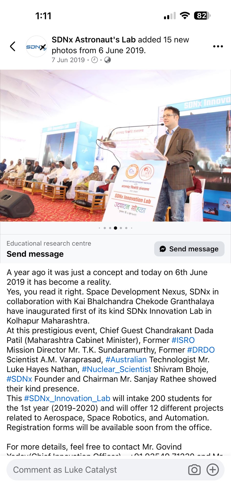
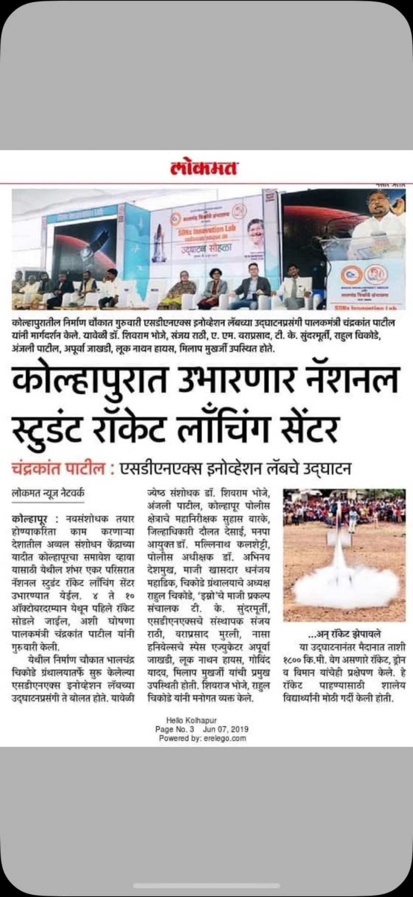

# Kolhapur, 6 June 2019: SDNx Innovation Lab and Luke's student challenge

[Main record](../../../README.md) · [Life and source record](../../../docs/life-record.md) · [Document archive](../../README.md) · [Manifest](manifest.json) · [Checksums](SHA256SUMS)

**Published here: 17 October 2026.** Two previously public screenshots are preserved unchanged: the SDNx event post showing Luke at the lectern, and a Marathi newspaper clipping about the opening and student rocket activity.

## The event and the records

The **SDNx Innovation Lab opened in Kolhapur, Maharashtra, on 6 June 2019**, through Space Development Nexus and the Bhalchandra Chikode Library. The saved **SDNx Astronaut's Lab** post is dated **7 June 2019** and identifies its photographs as being from 6 June. It describes an intended first-year intake of **200 students** and **12 projects** in aerospace, space robotics and automation.

The post names **Chandrakant Dada Patil**, Maharashtra cabinet minister, as chief guest. It also names former ISRO mission director T. K. Sundaramurthy, former DRDO scientist A. M. Varaprasad, Australian technologist “Luke Hayes Nathan”, nuclear scientist Shivram Bhoje and SDNx founder and chairman Sanjay Rathee. The wording of Luke's name is retained as it appears in the post. [Open the saved post](sdnx-kolhapur-luke-speaking-2019.jpeg).

The accompanying **Lokmat** clipping carries the footer **“Hello Kolhapur · Page No. 3 · Jun 07, 2019.”** It includes a photograph of the stage and a smaller rocket-launch photograph. The headline concerns a proposed national student rocket-launching centre in Kolhapur; the later [Virtual Solar Swarm origins page](https://github.com/auraofintelligence/virtual-solar-swarm/blob/2218529a43293c7004ae2be58225369280eff877/origins.html#L39) identifies a hundred-acre site and a first launch announced for early October 2019. The clipping is kept in its original Marathi. [Open the saved clipping](sdnx-kolhapur-news-2019.jpeg).

For the ministerial portfolios, a **PTI report dated 15 June 2019**, published by [Republic World](https://www.republicworld.com/india/politics/devendra-fadnavis-uddhav-thackeray-meet-to-talk-state-cabinet-expansion), describes revenue minister Chandrakant Patil as also handling agriculture. This supplies historical context for Luke's description of sharing the stage with Maharashtra's agriculture and revenue minister.

## The question Luke put to students

The [Virtual Solar Swarm origins page](https://github.com/auraofintelligence/virtual-solar-swarm/blob/2218529a43293c7004ae2be58225369280eff877/origins.html#L21) connects the Kolhapur talk to a specific design challenge:

**Imagine the satellite sensor packages that could monitor and measure roughly two hundred interesting objects in the solar system, assuming the space industry solves transport and the cost of getting them there. What would you send, and why?**

The page records the lab opening at Nirman Chowk, the talk, the audience and the lamp-lighting ceremony. Its captions describe model rockets, drones and aircraft flying after the ceremony. The [live origins page](https://auraofintelligence.github.io/virtual-solar-swarm/origins.html) also provides separate photographs of the talk, ceremony, stage and audience.

## Luke's explanation of the connection, 17 October 2026

Luke connects his early work on **patterns of observation and technology** with the later **Future Space Weather News** direction, the **solar-system satellite swarm** and his attraction to **Space Development Nexus in India**. In his account, those interests led into the Kolhapur occasion in 2019, where he was on stage with Maharashtra's agriculture and revenue minister for the opening of a **Space Tinkering Lab and student rocket competition**.

That causal account and the “Space Tinkering Lab” and “student rocket competition” wording were supplied by Luke on **17 October 2026**. The saved contemporary post calls the occasion the **SDNx Innovation Lab opening**. Together with the later talk account, the records connect an earlier public learning event with the observation, sensor and mission-design work developed in the current websites.

Related routes are the [earlier observation and technology history](../../../docs/ichooseinfinity-history.md), [Space Weather and Earth Resilience](https://auraofintelligence.github.io/space-weather-news/), [Virtual Solar Swarm](https://auraofintelligence.github.io/virtual-solar-swarm/) and [Aura Direct Hardware's learning chapter](https://auraofintelligence.github.io/aura-direct-hardware/learning.html).

## Preserved screenshots

### SDNx public event post

Copied without alteration from [Aura Direct Hardware's published image](https://github.com/auraofintelligence/aura-direct-hardware/blob/792dc79478cb9f02ef11b25218d5f8d379ba4892/assets/sdnx-kolhapur-luke-speaking-2019.jpeg). Its [source notes](https://github.com/auraofintelligence/aura-direct-hardware/blob/792dc79478cb9f02ef11b25218d5f8d379ba4892/sources.html#L194) record that Luke supplied the screenshots on 9 August 2026.

### Newspaper clipping

Copied without alteration from [Aura Direct Hardware's published image](https://github.com/auraofintelligence/aura-direct-hardware/blob/792dc79478cb9f02ef11b25218d5f8d379ba4892/assets/sdnx-kolhapur-news-2019.jpeg).

## Source trail and preservation

| Record | Permanent public source |
| --- | --- |
| Copied event-post screenshot | [Aura Direct Hardware: speaking image](https://github.com/auraofintelligence/aura-direct-hardware/blob/792dc79478cb9f02ef11b25218d5f8d379ba4892/assets/sdnx-kolhapur-luke-speaking-2019.jpeg) |
| Copied newspaper screenshot | [Aura Direct Hardware: news image](https://github.com/auraofintelligence/aura-direct-hardware/blob/792dc79478cb9f02ef11b25218d5f8d379ba4892/assets/sdnx-kolhapur-news-2019.jpeg) |
| Existing image provenance and SHA-256 values | [Aura Direct Hardware source notes](https://github.com/auraofintelligence/aura-direct-hardware/blob/792dc79478cb9f02ef11b25218d5f8d379ba4892/sources.html#L194) |
| F54 alias in the personal archive | [F54 image](https://github.com/auraofintelligence/luke-nathan-hayes-man-and-mind/blob/f040f5c259cd77f6377db2b7aaca840e36cae7c5/assets/archive/intake-20260906/f54.jpeg) · [register entry](https://github.com/auraofintelligence/luke-nathan-hayes-man-and-mind/blob/f040f5c259cd77f6377db2b7aaca840e36cae7c5/sources/register.json#L1140) |
| F19 alias in the personal archive | [F19 image](https://github.com/auraofintelligence/luke-nathan-hayes-man-and-mind/blob/f040f5c259cd77f6377db2b7aaca840e36cae7c5/assets/archive/intake-20260906/f19.jpeg) · [register entry](https://github.com/auraofintelligence/luke-nathan-hayes-man-and-mind/blob/f040f5c259cd77f6377db2b7aaca840e36cae7c5/sources/register.json#L228) |
| Later account of the talk and event | [Virtual Solar Swarm origins](https://github.com/auraofintelligence/virtual-solar-swarm/blob/2218529a43293c7004ae2be58225369280eff877/origins.html#L21) |
| Historical ministerial portfolios | [PTI / Republic World, 15 June 2019](https://www.republicworld.com/india/politics/devendra-fadnavis-uddhav-thackeray-meet-to-talk-state-cabinet-expansion) |

**F54 and F19 are related published versions of these records, with different file bytes.** They identify the event-post and newspaper sources in The Mind Behind the Man; they are not represented as checksum-identical copies of the two files preserved here. The manifest records both sets of hashes and their Git blob identities.

The two copied files match their public source files byte for byte. Their Git blob SHA-1 values also match the objects at the recorded Aura Direct Hardware commit. No cropping, resizing, recompression, translation or other image transformation was applied. The original photographs, social post and newspaper clipping retain their source rights and attributions.
